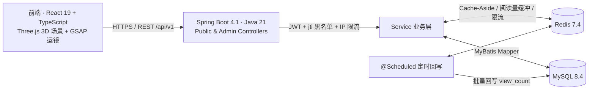

<div align="center">

# 孤剑夜行 · Lone Blade

**element_17 的 3D 交互个人网站（Full-Stack & Agent Engineer）**

*一块实时渲染的 WebGL 暮色河景，承载技术随笔、开源作品、个人履历与访客传书。*

[](https://github.com/element-17/element_17-website/actions/workflows/deploy.yml)


[](LICENSE)

</div>

---

## 站内一览

整个站点围绕一幅实时生成的 **Three.js 暮色河景** 展开——星空、水面倒影、乌篷船、篝火、远村与孤剑客在同一 3D 世界中串联起五个章节，切换页面时以平滑运镜穿梭其间，所有文章、项目与留言数据均由 Spring Boot + MySQL + Redis 后端实时驱动。

| 章节 | 入口 | 内容与体验 |
| :--- | :--- | :--- |
| `00` **首页** | `#home` | 3D 孤剑暮色主景、个人定位与站点总览 |
| `01` **随笔** | `#blog` | 技术文章与古卷式阅读弹窗（Markdown 安全渲染 + 实时阅读量统计） |
| `02` **作品** | `#projects` | 开源项目与全栈 / Agent 工程作品集中展示 |
| `03` **关于** | `#about` | 个人简介、技术栈与成长脉络 |
| `04` **联系** | `#contact` | 「飞鸽传书」访客留言板与外部社交入口 |

---

## 亮点设计

### 沉浸式 3D 与前端体验
- **程序化 WebGL 世界**：基于 Three.js 构建河岸地形、自定义 GLSL 水面倒影着色器、摇曳乌篷船、动态篝火、远山村落与主角剑客，配合 GSAP 完成章节运镜与鼠标视差。
- **首屏与渲染优化**：`three` 独立异步拆包，首帧以「入夜」过渡平滑衔接；支持 **低 / 中 / 高** 三档自适应画质切换、页面切后台自动暂停渲染循环、`prefers-reduced-motion` 减动效适配与 WebGL 不可用纯 CSS 优雅降级。
- **顺手交互**：支持底部章节导航、键盘 `←` / `→` 切换、数字键 `1`～`5` 直达、URL Hash 分享定位以及明暗主题切换。

### 生产级全栈后端与自动化部署
- **多级缓存与阅读量缓冲**：Redis Cache-Aside 缓存（随机抖动 TTL 防雪崩 + 空值占位防穿透 + Redis 异常自动降级直连 MySQL）；文章阅读量通过 Redis 10 分钟 IP UV 去重 + Hash 累加 + `@Scheduled` 定时批量回写 MySQL，消除写热点。
- **安全与鉴权**：单站长 JWT（HMAC-SHA256）+ BCrypt 密码加密，支持 `jti` 黑名单即时登出与 `tokenVersion` 改密全端失效；访客留言与登录均配备 Redis IP 限流防刷。
- **按需 CI/CD 流水线**：GitHub Actions 自动检测 `frontend/` 与 `backend/` 变更路径，按需触发编译、Lint、打包与 SSH 原子替换部署。

---

## 系统架构



---

## 本地运行

```bash
# 1. 启动本地数据库与缓存（自动执行建表与示例种子数据）
docker compose up -d

# 2. 启动 Spring Boot 后端（http://localhost:8080）
cd backend && ./mvnw spring-boot:run

# 3. 启动前端开发服务（http://localhost:5173）
cd frontend && npm install && npm run dev
```

---

## 延伸文档

若需查阅详细的接口契约、表结构或部署清单，请前往 [`docs/`](docs/README.md)：

- [架构与开发规范](docs/architecture.md) · [数据库与 Redis 设计](docs/database.md) · [RESTful 接口文档](docs/api.md) · [开发联调与部署指南](docs/deployment.md)

---

## 开源协议

本项目基于 [MIT License](LICENSE) 开源。
