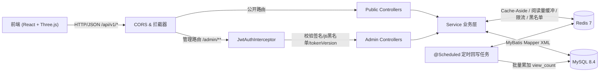

# 后端架构与开发规范

## 1. 整体架构



## 2. 包目录结构（`org.mywebsite.backend`）

```text
backend/
├── pom.xml
├── sql/
│   ├── schema.sql                       # 完整建表脚本（幂等 CREATE TABLE IF NOT EXISTS）
│   └── seed.sql                         # 初始化数据（与前端当前示例文案对齐，便于联调）
└── src/main/
    ├── java/org/mywebsite/backend/
    │   ├── BackendApplication.java      # 启动入口（@EnableScheduling / @MapperScan）
    │   ├── common/
    │   │   ├── api/                     # ApiResponse, PageResult, ErrorCode
    │   │   ├── exception/               # BizException, GlobalExceptionHandler
    │   │   └── util/                    # IpUtils, SlugUtils
    │   ├── config/
    │   │   ├── AppProperties.java       # @ConfigurationProperties(prefix = "app")
    │   │   ├── WebMvcConfig.java        # CORS 白名单 + JwtAuthInterceptor 注册
    │   │   ├── RedisConfig.java         # StringRedisTemplate / RedisTemplate 配置
    │   │   ├── OpenApiConfig.java       # SpringDoc OpenAPI + BearerAuth 安全定义
    │   │   └── AdminInitializer.java    # 首次启动幂等初始化站长账号（BCrypt 加密）
    │   ├── security/
    │   │   ├── JwtService.java          # HMAC-SHA256 签发与验签
    │   │   ├── AuthContext.java         # ThreadLocal 存放当前已认证管理员上下文
    │   │   ├── JwtAuthInterceptor.java  # 保护 /api/v1/admin/**（放行登录）
    │   │   └── RateLimitService.java    # 基于 Redis 的 IP 限流与登录防爆破
    │   ├── model/
    │   │   ├── entity/                  # 与数据表 1:1 对应的持久化实体
    │   │   ├── dto/                     # 入参请求对象（jakarta.validation 注解校验）
    │   │   └── vo/                      # 出参视图对象（避免实体直接暴露）
    │   ├── mapper/                      # MyBatis Mapper 接口
    │   ├── service/                     # 业务接口与实现（含缓存读写与定时落库）
    │   └── controller/
    │       ├── HealthController.java
    │       ├── PublicSiteController.java
    │       ├── PublicArticleController.java
    │       ├── PublicProjectController.java
    │       ├── PublicMessageController.java
    │       └── admin/                   # AdminAuth / Article / Project / Site / Message
    └── resources/
        ├── application.yaml
        └── mapper/*.xml                 # MyBatis XML SQL 映射
```

## 3. 核心技术设计

### 3.1 Redis 缓存策略（Cache-Aside）

- **读路径**：先查 Redis（JSON 字符串序列化），命中直接返回；未命中则查 MySQL，回填 Redis（TTL 30 分钟，叠加随机抖动 0~120 秒防雪崩）。
- **防穿透**：文章详情查库不存在时，向 Redis 写入短 TTL（2 分钟）的空占位值 `"__NULL__"`，避免恶意扫描不存在的 `slug` 打穿数据库。
- **写路径**：后台发生文章、作品、技能、站点配置的增删改后，先完成 MySQL 事务提交，再主动删除相关 Redis Key。
- **容错降级**：封装缓存工具类，当 Redis 短暂不可用时自动记录告警日志并回退直连 MySQL，保障网站基础可读性。

### 3.2 阅读量统计与定时落库

- 访客打开文章详情 `GET /api/v1/articles/{slug}` 时：
  1. 先查 `loneblade:article:uv:{slug}:{ip}`（`SETNX` + TTL 10 分钟），同 IP 10 分钟内多次刷新不重复计数。
  2. 首次有效访问执行 `HINCRBY loneblade:article:views {slug} 1`。
  3. 详情返回给前端的 `viewCount = MySQL基数 + Redis增量`，兼具实时性与零数据库写热点。
- 后台定时任务每 5 分钟扫描 `loneblade:article:views`，逐篇回写 `UPDATE article SET view_count = view_count + #{delta}`，成功后对 Redis Hash 执行 `HINCRBY -delta`（避免并发增量丢失）。

### 3.3 单站长 JWT 认证与安全

- **密码哈希**：使用 `BCryptPasswordEncoder`（强度 10），数据库永不存明文密码。
- **登录防爆破**：同一 `username + IP` 连续 5 次密码错误，写入 Redis 计数并锁定 15 分钟。
- **JWT 载荷**：`sub`（username）、`uid`（adminId）、`jti`（UUID）、`ver`（`token_version`）、`iat`、`exp`。
- **立即失效机制**：
  - 主动登出：把当前 Token 的 `jti` 写入 Redis 黑名单，TTL 为 Token 剩余有效时间。
  - 修改密码：数据库 `sys_admin.token_version + 1` 并更新 Redis 缓存版本，所有历史签发的旧 Token 立即失效。

### 3.4 「传书」访客留言限流

- 对 `POST /api/v1/messages` 按客户端 IP 做两级 Redis 限流：
  - **短间隔冷却**：同一 IP 30 秒内最多提交 1 次。
  - **窗口限额**：同一 IP 10 分钟内最多提交 5 次。
- 超限时返回 HTTP `429 Too Many Requests` 与业务码 `42901`。

## 4. 开发与编码约定

1. **所有外部入参**必须经过 `@Valid` + Bean Validation 校验，非法参数由 `GlobalExceptionHandler` 统一转换为 `40001`。
2. **MyBatis SQL** 统一放在 `src/main/resources/mapper/*.xml`，禁止使用 `${}` 拼接用户输入，全部使用 `#{}` 预编译参数防止 SQL 注入。
3. **时间格式**统一使用 `LocalDateTime` + ISO-8601（`yyyy-MM-dd HH:mm:ss` 或标准时间戳），数据库时区统一为 `Asia/Shanghai`。
4. **敏感配置**（数据库密码、Redis 密码、JWT 密钥、初始站长密码）全部支持通过环境变量覆盖，严禁把生产密钥提交进 Git。
