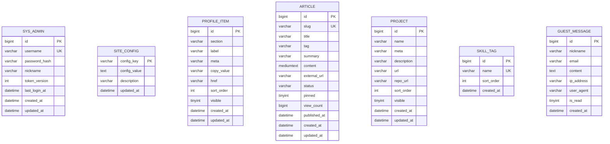

# 数据库与 Redis 设计文档

数据库版本：**MySQL 8.4**，默认库名 `lone_blade`，字符集 `utf8mb4`，排序规则 `utf8mb4_0900_ai_ci`。  
缓存版本：**Redis 7**，所有 Key 统一前缀 `loneblade:`。

---

## 1. ER 关系概览

---

## 2. MySQL 表结构明细

完整可执行建表脚本见 `backend/sql/schema.sql`，初始种子数据见 `backend/sql/seed.sql`。

### 2.1 `sys_admin`（站长账号表）

| 字段 | 类型 | 约束 | 说明 |
| --- | --- | --- | --- |
| `id` | `BIGINT` | PK, AUTO_INCREMENT | 主键 |
| `username` | `VARCHAR(64)` | NOT NULL, UNIQUE | 登录用户名 |
| `password_hash` | `VARCHAR(100)` | NOT NULL | BCrypt 密码哈希 |
| `nickname` | `VARCHAR(64)` | NOT NULL | 展示昵称 |
| `token_version` | `INT` | NOT NULL DEFAULT 1 | Token 版本号，修改密码自增以作废旧 Token |
| `last_login_at` | `DATETIME` | NULL | 最近登录时间 |
| `created_at` | `DATETIME` | NOT NULL DEFAULT CURRENT_TIMESTAMP | 创建时间 |
| `updated_at` | `DATETIME` | NOT NULL DEFAULT CURRENT_TIMESTAMP ON UPDATE | 更新时间 |

### 2.2 `site_config`（站点配置键值表）

用于动态维护首页与各模块的介绍文案，无需重新发版。

| 字段 | 类型 | 约束 | 说明 |
| --- | --- | --- | --- |
| `config_key` | `VARCHAR(64)` | PK | 配置键（如 `site.name`, `site.tagline`, `about.desc`） |
| `config_value` | `TEXT` | NOT NULL | 配置值 |
| `description` | `VARCHAR(128)` | NULL | 说明 |
| `updated_at` | `DATETIME` | NOT NULL DEFAULT CURRENT_TIMESTAMP ON UPDATE | 更新时间 |

预置键清单：
- `site.name`（孤剑夜行）、`site.nameEn`（LONE BLADE）、`site.subtitle`（A Developer's World）、`site.tagline`（十年磨一剑，霜刃未曾试。）
- `blog.desc`、`projects.desc`、`about.desc`、`contact.desc`

### 2.3 `profile_item`（来历 & 传书自定义条目表）

对应前端 `about`（所在/所长/近况）与 `contact`（Email / GitHub 等）条目列表。

| 字段 | 类型 | 约束 | 说明 |
| --- | --- | --- | --- |
| `id` | `BIGINT` | PK, AUTO_INCREMENT | 主键 |
| `section` | `VARCHAR(32)` | NOT NULL, INDEX | 所属模块：`about` 或 `contact` |
| `label` | `VARCHAR(64)` | NOT NULL | 条目标签（如 `所在`、`Email`） |
| `meta` | `VARCHAR(255)` | NOT NULL | 展示内容（如 `江湖 · 远程`） |
| `copy_value` | `VARCHAR(255)` | NULL | 非空时前端渲染一键复制按钮 |
| `href` | `VARCHAR(512)` | NULL | 非空时前端渲染外链 |
| `sort_order` | `INT` | NOT NULL DEFAULT 0 | 升序排序权重 |
| `visible` | `TINYINT(1)` | NOT NULL DEFAULT 1 | 是否公开展示 |
| `created_at` | `DATETIME` | NOT NULL DEFAULT CURRENT_TIMESTAMP | 创建时间 |
| `updated_at` | `DATETIME` | NOT NULL DEFAULT CURRENT_TIMESTAMP ON UPDATE | 更新时间 |

索引：`idx_profile_section_sort (section, visible, sort_order)`。

### 2.4 `article`（藏卷文章表）

| 字段 | 类型 | 约束 | 说明 |
| --- | --- | --- | --- |
| `id` | `BIGINT` | PK, AUTO_INCREMENT | 主键 |
| `slug` | `VARCHAR(128)` | NOT NULL, UNIQUE | URL 唯一标识（如 `css-3d-camera`） |
| `title` | `VARCHAR(180)` | NOT NULL | 文章标题 |
| `tag` | `VARCHAR(64)` | NOT NULL | 主分类标签（如 `图形交互`） |
| `summary` | `VARCHAR(500)` | NOT NULL | 摘要（古卷弹窗导语） |
| `content` | `MEDIUMTEXT` | NOT NULL | 正文（支持 Markdown / 换行分段） |
| `external_url` | `VARCHAR(512)` | NULL | 可选原文外链 |
| `status` | `VARCHAR(16)` | NOT NULL DEFAULT 'DRAFT' | `DRAFT`（草稿）/ `PUBLISHED`（已发布） |
| `pinned` | `TINYINT(1)` | NOT NULL DEFAULT 0 | 是否置顶 |
| `view_count` | `BIGINT` | NOT NULL DEFAULT 0 | 已落库的累计阅读量 |
| `published_at` | `DATETIME` | NULL | 首次发布时间 |
| `created_at` | `DATETIME` | NOT NULL DEFAULT CURRENT_TIMESTAMP | 创建时间 |
| `updated_at` | `DATETIME` | NOT NULL DEFAULT CURRENT_TIMESTAMP ON UPDATE | 更新时间 |

索引：
- `uk_article_slug (slug)`
- `idx_article_pub_list (status, pinned DESC, published_at DESC)`
- `idx_article_tag (status, tag)`

### 2.5 `project`（铸剑作品表）

| 字段 | 类型 | 约束 | 说明 |
| --- | --- | --- | --- |
| `id` | `BIGINT` | PK, AUTO_INCREMENT | 主键 |
| `name` | `VARCHAR(128)` | NOT NULL | 作品名 |
| `meta` | `VARCHAR(128)` | NOT NULL | 技术简标（如 `Three.js / React`） |
| `description` | `VARCHAR(500)` | NOT NULL | 作品简介 |
| `url` | `VARCHAR(512)` | NULL | 在线访问链接 |
| `repo_url` | `VARCHAR(512)` | NULL | 源码仓库链接 |
| `sort_order` | `INT` | NOT NULL DEFAULT 0 | 升序排序 |
| `visible` | `TINYINT(1)` | NOT NULL DEFAULT 1 | 是否在前台展示 |
| `created_at` | `DATETIME` | NOT NULL DEFAULT CURRENT_TIMESTAMP | 创建时间 |
| `updated_at` | `DATETIME` | NOT NULL DEFAULT CURRENT_TIMESTAMP ON UPDATE | 更新时间 |

索引：`idx_project_visible_sort (visible, sort_order)`。

### 2.6 `skill_tag`（铸剑技术栈标签表）

| 字段 | 类型 | 约束 | 说明 |
| --- | --- | --- | --- |
| `id` | `BIGINT` | PK, AUTO_INCREMENT | 主键 |
| `name` | `VARCHAR(64)` | NOT NULL, UNIQUE | 标签名（如 `React`, `Three.js`） |
| `sort_order` | `INT` | NOT NULL DEFAULT 0 | 排序权重 |
| `created_at` | `DATETIME` | NOT NULL DEFAULT CURRENT_TIMESTAMP | 创建时间 |

### 2.7 `guest_message`（传书访客留言表）

| 字段 | 类型 | 约束 | 说明 |
| --- | --- | --- | --- |
| `id` | `BIGINT` | PK, AUTO_INCREMENT | 主键 |
| `nickname` | `VARCHAR(64)` | NOT NULL | 访客称呼 |
| `email` | `VARCHAR(128)` | NULL | 访客联系邮箱（可选） |
| `content` | `TEXT` | NOT NULL | 留言正文（限 1000 字） |
| `ip_address` | `VARCHAR(64)` | NOT NULL | 来源 IP（审计与防刷） |
| `user_agent` | `VARCHAR(255)` | NULL | 浏览器 UA |
| `is_read` | `TINYINT(1)` | NOT NULL DEFAULT 0 | 是否已读 |
| `created_at` | `DATETIME` | NOT NULL DEFAULT CURRENT_TIMESTAMP | 留言时间 |

索引：`idx_message_read_time (is_read, created_at DESC)`。

---

## 3. Redis Key 规划

| Key 模式 | 数据类型 | TTL | 用途与更新策略 |
| --- | --- | --- | --- |
| `loneblade:site:overview` | String (JSON) | 30 min (+随机抖动) | 聚合站点配置 + 来历/传书条目 + 技能标签；后台修改站点/技能时主动删除 |
| `loneblade:projects:public` | String (JSON) | 30 min (+随机抖动) | 前台可见作品列表；后台增删改作品时主动删除 |
| `loneblade:article:tags` | String (JSON) | 30 min (+随机抖动) | 已发布文章标签统计；文章变更时主动删除 |
| `loneblade:article:detail:{slug}` | String (JSON) | 30 min（空值 2 min） | 已发布文章详情缓存；编辑/撤回/删除该文章时主动删除 |
| `loneblade:article:views` | Hash (`slug -> delta`) | 永久（定期扣减） | 阅读量增量缓冲；每 5 分钟批量落库 MySQL 并原子 `HINCRBY -delta` |
| `loneblade:article:uv:{slug}:{ip}` | String (`"1"`) | 10 min | 阅读量防刷去重（同 IP 10 分钟计一次） |
| `loneblade:auth:blacklist:{jti}` | String (`"1"`) | Token 剩余 TTL | 已登出 JWT 黑名单 |
| `loneblade:auth:ver:{adminId}` | String (int) | 24 h | 缓存站长当前 `token_version`，修改密码立即刷新 |
| `loneblade:auth:fail:{user}:{ip}` | String (int) | 15 min | 登录密码连续错误计数，达 5 次触发 15 分钟锁定 |
| `loneblade:ratelimit:msg:cd:{ip}` | String (`"1"`) | 30 s | 传书留言短间隔冷却 |
| `loneblade:ratelimit:msg:win:{ip}` | String (int) | 10 min | 传书留言滑动计数（上限 5 次） |
